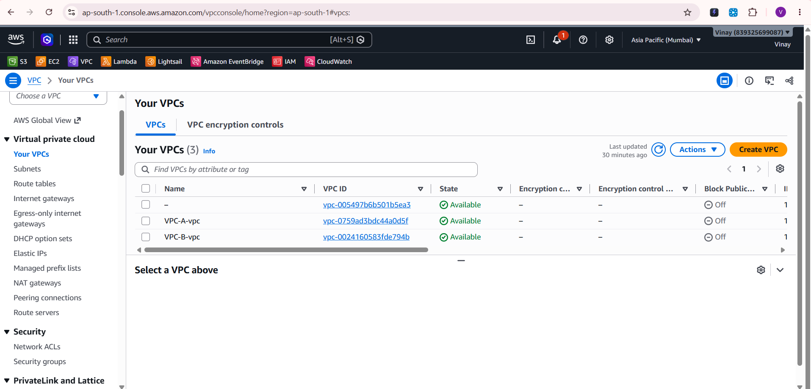
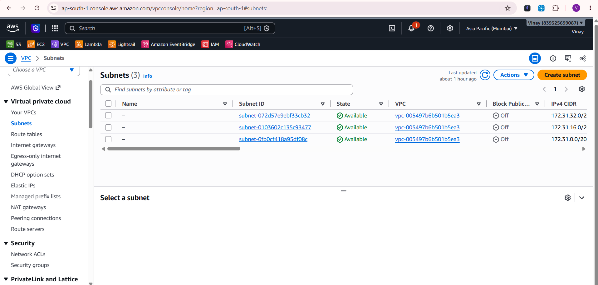
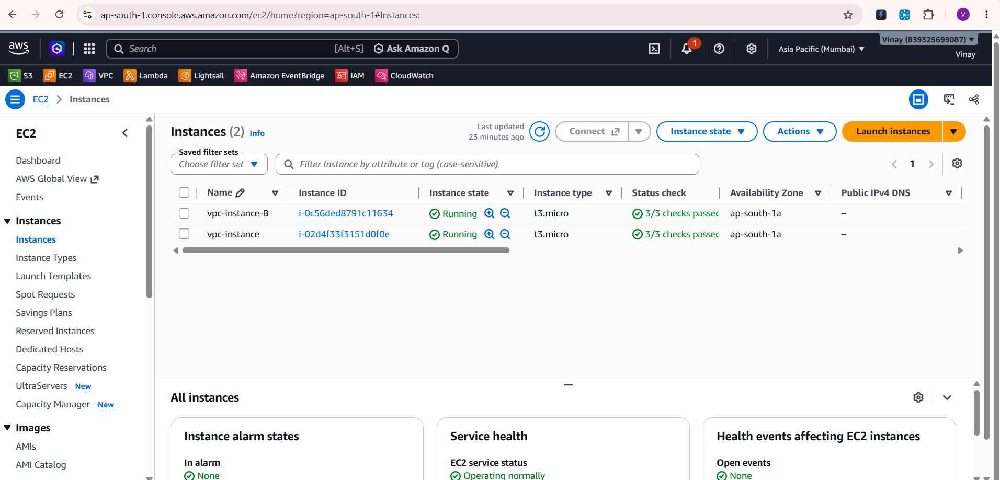
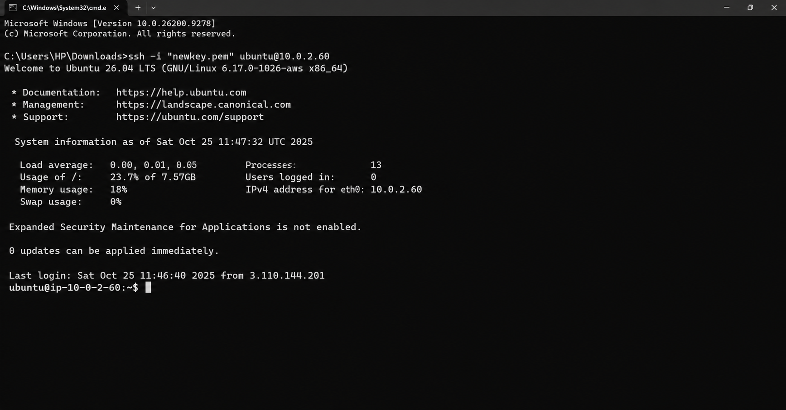
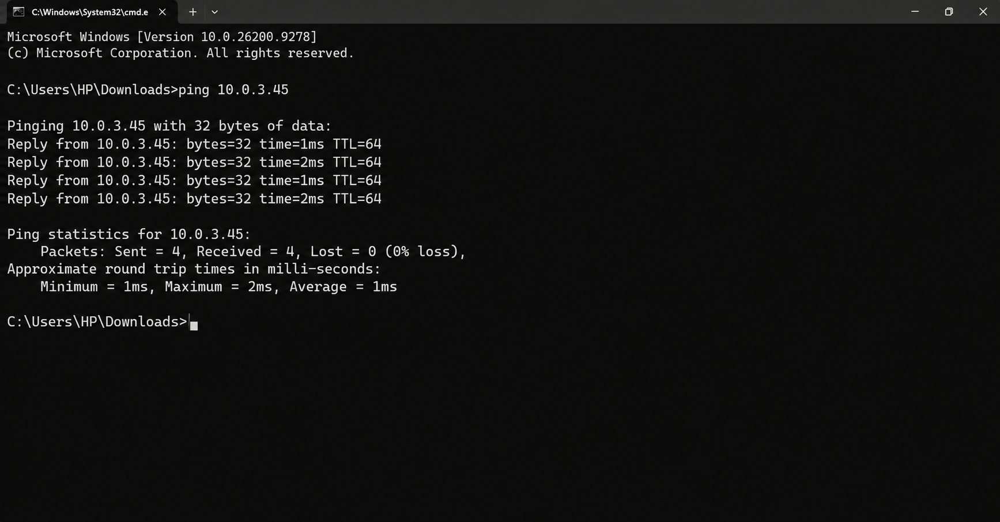

# AWS VPC Peering: Private Connectivity Between Two VPCs

Connect two isolated Amazon VPCs using **VPC Peering** so EC2 instances in each network communicate over **private IP addresses**, without using the public internet.

**Region:** Asia Pacific (Mumbai) `ap-south-1`

---

## Architecture

```
        VPC-A (10.0.0.0/16)                       VPC-B (10.1.0.0/16)
   ┌──────────────────────────┐             ┌──────────────────────────┐
   │ Subnet 10.0.1.0/24       │             │ Subnet 10.1.1.0/24       │
   │   EC2: vpc-instance      │             │   EC2: vpc-instance-B    │
   └────────────┬─────────────┘             └────────────┬─────────────┘
                └────────── VPC Peering Connection ──────┘
```

## Network Plan

| Resource | VPC-A (`VPC-A-vpc`) | VPC-B (`VPC-B-vpc`) |
|---|---|---|
| VPC CIDR | `10.0.0.0/16` | `10.1.0.0/16` |
| Subnet CIDR | `10.0.1.0/24` | `10.1.1.0/24` |
| EC2 instance | `vpc-instance` (t3.micro) | `vpc-instance-B` (t3.micro) |
| Route to peer | `10.1.0.0/16` → Peering | `10.0.0.0/16` → Peering |

> The two VPC CIDR blocks must **not overlap**, otherwise AWS cannot create the peering connection.

## Requirements

- AWS Free Tier account
- Basic knowledge of the AWS Console
- IAM permissions to create VPC, EC2 and networking resources

---

## Implementation Steps

### Step 1: Create two VPCs
**VPC → Create VPC → VPC only**
- `VPC-A-vpc`: `10.0.0.0/16`
- `VPC-B-vpc`: `10.1.0.0/16`

### Step 2: Create subnets
One subnet in each VPC: `10.0.1.0/24` in VPC-A and `10.1.1.0/24` in VPC-B.

### Step 3: Launch EC2 instances
1. Launch `vpc-instance` in VPC-A and `vpc-instance-B` in VPC-B (Ubuntu, t3.micro) using the subnets above
2. Configure security groups:

| Instance | Rule | Source |
|---|---|---|
| VPC-A | SSH (22) | Your IP (lab use only: restrict, do not use `0.0.0.0/0` in real setups) |
| VPC-A | All ICMP - IPv4 | `10.1.0.0/16` |
| VPC-B | All ICMP - IPv4 | `10.0.0.0/16` |

3. Note the **private IP** of both instances

### Step 4: Create the VPC peering connection
1. **VPC → Peering connections → Create peering connection**
2. Requester: `VPC-A-vpc`, Accepter: `VPC-B-vpc`
3. Select the request → **Actions → Accept request**. Status should become **Active**.

### Step 5: Update route tables
| Route table of | Destination | Target |
|---|---|---|
| VPC-A | `10.1.0.0/16` | Peering connection (`pcx-...`) |
| VPC-B | `10.0.0.0/16` | Peering connection (`pcx-...`) |

### Step 6: Test connectivity
1. Connect to `vpc-instance` (VPC-A) using SSH or EC2 Instance Connect
2. From inside that instance, ping the private IP of `vpc-instance-B`:
   ```bash
   ping <private-ip-of-vpc-instance-B>
   ```
3. Replies with 0% packet loss confirm the peering works

---

## Screenshots

### VPC List


### Subnets


### EC2 Instances


## SSH Success


### Successful Cross-VPC Ping (run from VPC-A instance)


---

## What I Learned

- How AWS VPCs provide logically isolated networks
- CIDR notation and subnetting basics
- Security groups: allowing ICMP between specific CIDR ranges
- Creating and accepting a VPC peering connection
- Configuring routes on both sides of a peering connection
- Testing private connectivity with ping

## Important Notes

- VPC peering is **not transitive**: if A is peered with B and B with C, A cannot reach C through B
- Both route tables and security groups must allow the traffic
- Peered VPCs must have non-overlapping CIDR blocks

## Cleanup

Delete in this order to avoid charges: EC2 instances → peering connection → subnets → VPCs (and any Internet Gateways or Elastic IPs, if created).

## Author

**Vinay** – [GitHub](https://github.com/Vinay-PR-Gowda)
